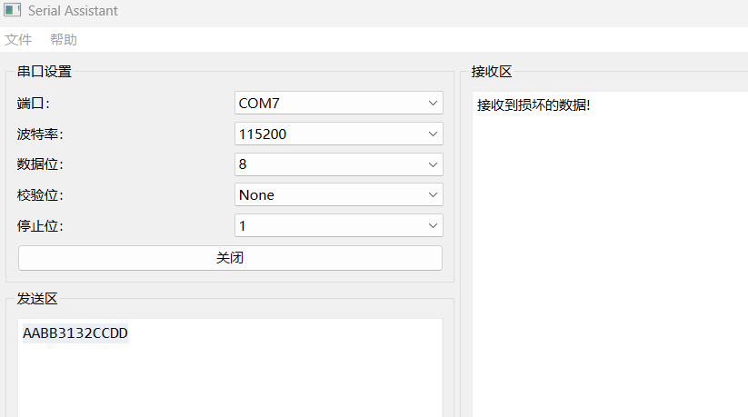
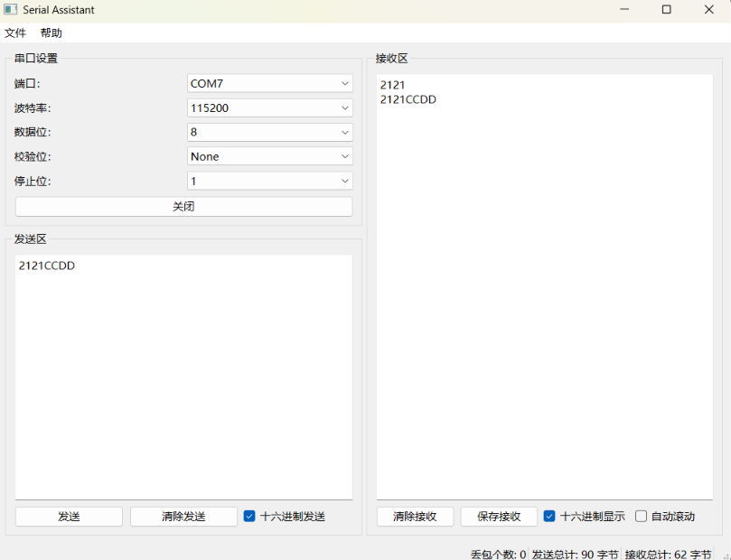
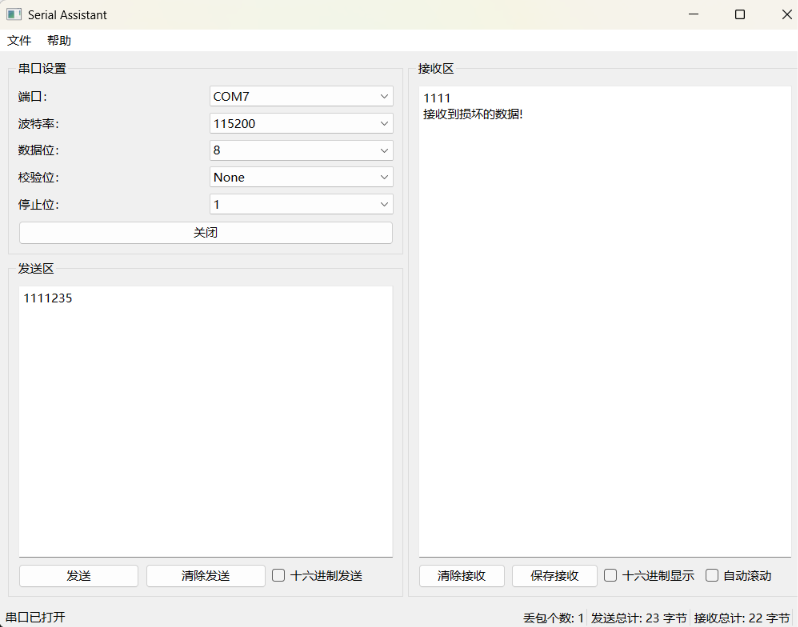
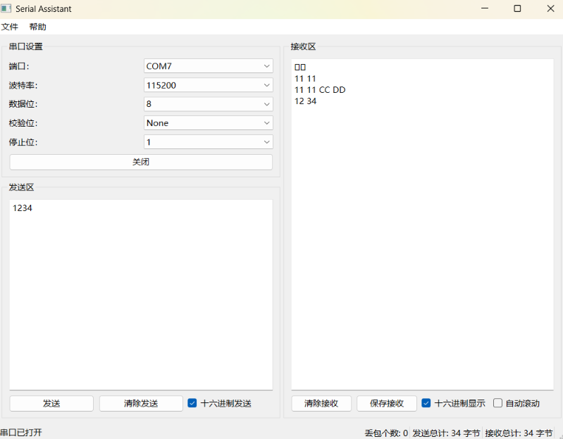
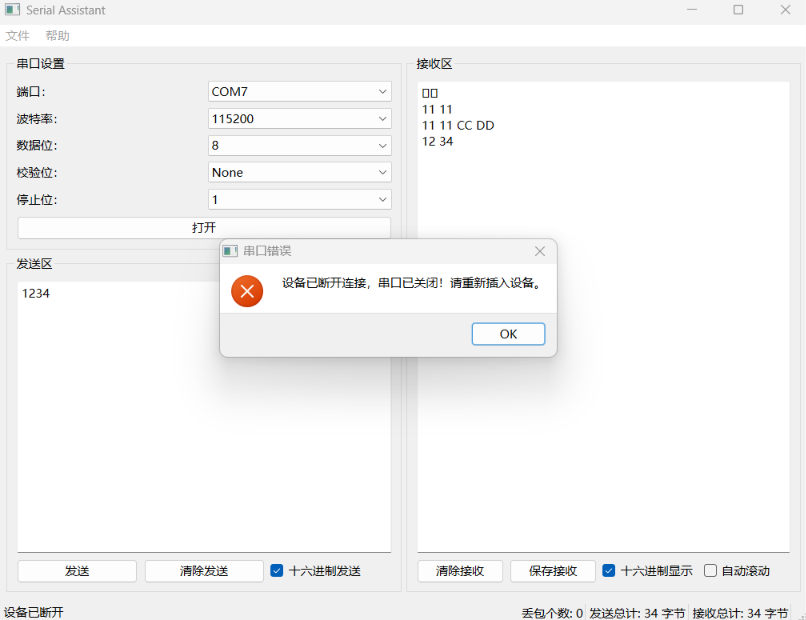

# 串口助手（Serial Assistant）

串口助手是一款基于 Qt 的串口通信调试工具，提供图形化界面用于串口收发测试、协议调试与异常场景验证。


> 本项目为迭代版本，重点验证了「异常捕获」与「数据结构（缓冲区 + 帧协议）」两类能力，详见下文「优化记录」。

## 功能特性

- **串口配置**：波特率、数据位、校验位、停止位可选。
- **十六进制收发**：支持十六进制格式的发送与显示。
- **长度字段协议组帧**：帧头 + 数据长度 + 数据体 + CRC，解决粘包/拆包问题。
- **CRC 校验**：CRC16-Modbus（初值 0xFFFF，多项式 0xA001），校验错误自动识别并记录。
- **缓冲区管理**：`QByteArray` 累积接收，按帧边界拆包，保证数据完整性。
- **异常捕获**：`errorOccurred` 信号 + 定时轮询双重检测，USB 热拔时自动关闭串口、复位界面并弹窗提示。
- **状态显示**：实时显示发送/接收字节数与丢包数。
- **日志记录**：损坏数据包写入日志文件。

## 协议说明

发送与接收采用**长度字段协议**，一帧格式如下：

```
+----------+------------------+----------+-----------+
| 帧头     | 数据长度         | 数据体   | CRC       |
| 2 字节   | 2 字节(大端)     | N 字节   | 2 字节    |
| AA BB    | 00 NN            | ...      | 高字节在前 |
+----------+------------------+----------+-----------+
```

- **帧头**：固定 `AA BB`，用于同步帧边界。
- **数据长度**：2 字节大端，表示数据体字节数（最大 4096）。
- **数据体**：N 字节原始数据。
- **CRC**：对「帧头 + 数据长度 + 数据体」计算的 CRC16-Modbus，结果按大端存放。

> 与旧版「起始/结束标志」定界协议相比，长度字段协议在数据本身包含结束标志、或一帧被拆成多次到达时都不会误判，从根本上解决粘包/拆包问题。

## 优化记录

本项目在迭代中解决了三个典型问题，均通过硬件回环测试验证。

### 优化点 1：十六进制收发

**问题**：界面上的「十六进制发送/显示」勾选框一直存在，但代码从未读取，实际发送时始终按 UTF-8 文本发送，十六进制输入被当作普通字符串二次处理。

**修复前**（刚加上十六进制时，沿用旧定界协议导致 `CC DD` 帧错乱）：



**修复后**（十六进制正常收发）：



### 优化点 2：缓冲区 + 长度字段协议（解决粘包/拆包）

**问题**：旧实现采用「帧头 + 数据 + 结束标志」定界协议。串口是字节流，一帧可能被拆成多次到达——例如手动输入时停顿 2 秒再继续输入，结束标志与 CRC 会跨多次 `readyRead` 拆分，解析器在半帧时就误判「接收到损坏的数据」。

**修复前**（停顿 2 秒后发送 → 数据错误）：



**方案**：改用 `QByteArray m_buffer` 累积数据，配合长度字段协议按帧边界拆包。关键注释：

```cpp
// 此处使用接收缓冲区解决高频数据下的粘包/拆包问题：
// 串口是字节流，一帧可能被拆成多次 readyRead，也可能多帧粘在一起一次到达，
// 所以先用 m_buffer 累积数据，再按长度字段协议拆出完整帧。
```

**修复后**（停顿输入正常，无数据错误）：



### 优化点 3：USB 热拔异常捕获

**问题**：串口打开状态下热拔 USB 线，Windows 上 `errorOccurred(ResourceError)` 不一定可靠触发，程序无任何反应。

**方案**：`errorOccurred` 信号 + `QTimer` 定时轮询 `QSerialPortInfo::availablePorts()` 双重检测，检测到掉线后统一走 `handleDeviceDisconnected()`：关闭串口、清空缓冲区、复位界面、弹窗提示。

```cpp
connect(serial, &QSerialPort::errorOccurred, this, &SerialAssistant::handleError);
```

**修复后**（拔线弹窗，程序不崩溃）：



## 安装

### 环境要求

- Qt 5/6
- C++17 编译器（如 GCC 或 MSVC）

### 编译步骤

1. 克隆项目代码：
    ```sh
    git clone <仓库地址>
    cd <项目目录>
    ```

2. 使用 Qt Creator 打开项目文件（`.pro` 文件），或在命令行中运行：
    ```sh
    qmake
    make
    ```

3. 运行生成的可执行文件。

## 使用说明

1. 启动程序后，选择合适的串口配置（端口、波特率、数据位、校验位、停止位）。
2. 选择串口并点击「打开」按钮。
3. 在发送区输入数据（可勾选「十六进制发送」输入 hex），点击「发送」按钮。
4. 接收的数据显示在接收窗口（可勾选「十六进制显示」）。
5. 状态栏可查看发送/接收字节数与丢包数。
6. 串口打开状态下热拔设备，程序会自动关闭串口并弹窗提示，不会崩溃。

## 贡献

如果你想为该项目做出贡献，请遵循以下步骤：

1. Fork 本仓库。
2. 创建你的特性分支 (`git checkout -b feature/AmazingFeature`)。
3. 提交你的更改 (`git commit -m 'Add some AmazingFeature'`)。
4. 推送到分支 (`git push origin feature/AmazingFeature`)。
5. 打开一个 Pull Request。

## 许可证

该项目使用 MIT 许可证。详情请参见 [LICENSE](LICENSE) 文件。
